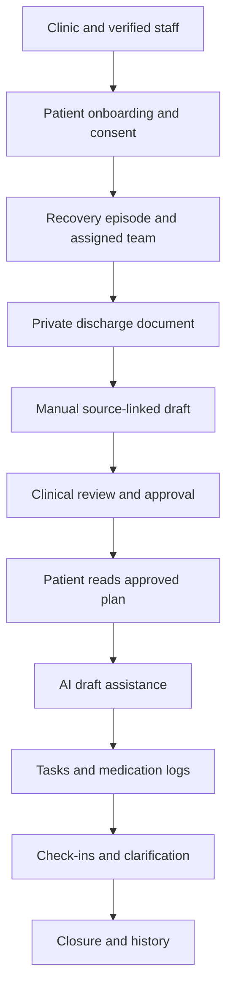

# Velora

**Secure, clinician-controlled post-discharge recovery coordination.**

Velora is a planned JavaScript MERN application that helps clinics convert private discharge information into clinician-approved recovery plans. Patients and explicitly authorized caregivers will later use those approved plans to understand instructions, record recovery activity and ask the assigned care team for clarification.

Velora does **not** diagnose, prescribe, decide clinical urgency, certify recovery or publish AI output automatically. AI assistance is planned only after the manual clinical review and approval workflow is implemented and verified.

> **Current status - 12 October 2026:** **Parts 1-5 are implemented and verified locally** - repository, authentication (Argon2id, revocable cookie sessions, mandatory staff MFA, CSRF, reset/invite), clinic permissions, patient onboarding with consent history and scoped caregiver access, recovery episodes with care-team assignment and atomic draft discharge corrections, private encrypted discharge documents, and **manual source-linked care plans with clinical review, clarification, approval and immutable versioning**. Part 5 completes the first synthetic **M1 vertical slice**: patient -> episode -> ready document -> manual draft -> clinical review -> approval -> patient's current approved view, with approval activating no task or reminder. See [docs/VELORA_SESSION_LOG.md](docs/VELORA_SESSION_LOG.md) for evidence and remaining limits. No production deployment or clinical validation yet.

## Project authority

Read these three documents before implementation and whenever the owner says **Duck**:

| Document | Purpose |
|---|---|
| [Velora MERN Master](docs/VELORA_MERN_MASTER.pdf) | Product scope, VEL-001 through VEL-021, ten-part roadmap, clinical invariants and all 25 permanent security controls |
| [Velora MERN Architecture](docs/VELORA_MERN_ARCHITECTURE.pdf) | MERN system design, trust boundaries, data model, access policy, state machines, repository structure and verification strategy |
| [Velora MERN Duck Log](docs/VELORA_MERN_DUCK_LOG.pdf) | Current project truth, evidence classifications, Duck review procedure, completion gates and session history |

These PDFs are the current project authority. Code, tests and future documentation must remain consistent with them. A roadmap item is not evidence that a feature exists.

## Product flow



Manual clinical approval comes before AI assistance. Uploading a document or receiving an AI result can never activate patient instructions, tasks or reminders.

## Technology decision

The rebuild uses **JavaScript only**:

- **MongoDB + Mongoose** for persistence, indexes and replica-set transactions
- **Express.js + Node.js** for the API, authorization, workflows and provider boundaries
- **React.js + Vite** for accessible role-specific interfaces
- **Playwright** for browser journeys and viewport verification

The repository shape:

```text
Velora/
  client/
  server/
  docs/
  .github/workflows/
  .env.example
  .gitignore
  README.md
```

Dependencies are pinned in `package-lock.json` and reviewed with `npm audit` (no production advisories at Part 4 close). No external storage, AI/OCR, antivirus, notification, queue, hosting or managed database provider has been selected; Part 4 stores documents through a provider-neutral interface with an encrypted local provider, and any vendor remains deferred and must be disclosed before use (control #22).

## Ten-part delivery plan

| Part | Deliverable | State |
|---:|---|---|
| 1 | Repository, authentication and clinic permissions | Implemented / verified locally |
| 2 | Patient onboarding, consent and caregiver access | Implemented / verified locally |
| 3 | Recovery episodes and care-team assignment | Implemented / verified locally |
| 4 | Private discharge-document intake | Implemented / verified locally |
| 5 | Manual care plans, review, approval and versioning | Implemented / verified locally - completes synthetic M1 |
| 6 | AI extraction, source citations and reviewed language | Implemented / verified locally |
| 7 | Medication schedules, daily tasks and actor-attributed logs | Implemented / verified locally |
| 8 | Check-ins, clarification queue, dashboard and reminders | Planned |
| 9 | Closure, audit, privacy requests, retention and metrics | Planned |
| 10 | Production hardening, restore and clinical-readiness gate | Planned |

Code 2 diagnostic tests/results and Code 3 insurance remain outside the active scope.

## Roles and access boundaries

| Role | Boundary |
|---|---|
| Patient | Own records and the current approved plan; no clinical approval, no drafts |
| Caregiver | Only explicitly active granular scopes; no automatic document or plan access, no onward invitation |
| Care coordinator | Assigned operational coordination and manual draft authoring; no clinical publication |
| Clinical reviewer | Assigned review, clarification and approval after clinic eligibility verification |
| Clinic admin | Staff and settings administration; admin status alone grants no clinical-record browsing or approval |

Every protected operation must be enforced on the Express server using the authenticated identity, clinic, role, ownership or active assignment/grant, requested action and workflow state. React route protection is a user-interface layer, not the authorization boundary.

## Permanent security rules

- Real secrets, keys and credentials never enter Git, React bundles, screenshots, logs or error responses.
- `MONGODB_URI` and every credential are server-only environment variables.
- Commit `.env.example` with names and placeholders only. Never commit `.env` or `.env.*` files containing values.
- Passwords use Argon2id or bcrypt and are never stored in plaintext or reversible encryption.
- Use revocable server-side sessions in secure `httpOnly` cookies, MFA for staff, CSRF protection and an exact CORS allowlist.
- Validate and sanitize bodies, params, queries, headers, forms, filenames and uploads. Prevent NoSQL/operator injection and XSS.
- Apply security headers, safe structured errors, rate/resource limits, dependency audits and Git tree/history secret scans.
- Before any external API, disclose provider, purpose, API-key name, environment variable and exact backend/frontend location.
- Security is verified throughout every part, followed by an explicit end-of-part audit.

The complete 25-point contract is defined in the Master PDF and repeated in every implementation prompt.

## One-viewport application rule

Every authenticated application screen must fit within one viewport without page-level vertical scrolling.

- Long forms use multi-step wizards.
- Long lists and tables use server pagination.
- Many sections use tabs or separate routes.
- Charts use switchable panels.
- Mobile shows one primary panel at a time.
- `overflow: hidden` must never cut required content.

Required verification sizes are `1440x900`, `768x1024`, `390x844`, `320x568`, `844x390` and `320x400`. A marketing landing page may intentionally scroll.

## Duck review

At the start and end of every part:

1. Read the three authority PDFs and repository instructions.
2. Inspect the real branch, commit, dirty tree, source, configuration, dependencies, tests and CI.
3. Map behavior to VEL requirements, the active part and all 25 security controls.
4. Classify evidence as `VERIFIED`, `IMPLEMENTED / UNVERIFIED`, `PARTIAL`, `PLANNED`, `DRIFT` or `BLOCKED`.
5. Fix authorized in-scope drift, run the relevant checks and update the Duck Log.
6. Report exact evidence, failed or unavailable checks, remaining risks and the next authorized action.

Passing tests do not establish zero bugs, clinical validation, regulatory compliance or production readiness.

## Development and Git discipline

### Setup (verified)

Requirements: Node.js >= 20.11 and a local MongoDB **replica set**. From Part 2 on, patient/consent/
caregiver (and episode) writes run inside transactions, so the application database must be a replica
set (or mongos).

```bash
npm install                                     # installs server + client + e2e workspaces
npm run mongo:test-rs -w server                 # start the local single-node replica set (:27019)
cp .env.example .env                            # then fill in values (see below)
npm run gen:env                                 # generates safe local values for the two secrets
npm run seed -w server                          # synthetic clinic + one user per role (refreshes roles)
npm run dev                                     # API on :4000, client on :5173
```

Part 4 adds private encrypted document storage. `DOCUMENT_STORAGE_ROOT` must be an **absolute path
outside the repository** and `DOCUMENT_ENCRYPTION_KEY` a separate 32-byte base64 key; a relative or
in-repo root fails startup, and the root without its key is refused (it would store plaintext).
Provider-neutral interface, encryption format, HTTP contract and the recovery runbook are documented
in [docs/VELORA_DOCUMENT_STORAGE.md](docs/VELORA_DOCUMENT_STORAGE.md).

Part 5 adds manual care plans with clinical review and approval. The state machine, clinical-field
rules (a missing, unclear or conflicting dose, frequency or duration is never guessed and blocks
approval), authority matrix, HTTP contract and the single approval transaction are documented in
[docs/VELORA_CARE_PLAN.md](docs/VELORA_CARE_PLAN.md).

Part 6 adds optional, source-linked AI-assisted draft extraction and reviewed Hindi/English
presentation. **AI is an untrusted drafting tool with zero approval/publishing/prescribing
authority**, and the manual Part 5 workflow runs unchanged when AI is unavailable - which is the
**shipped default** (`EXTRACTION_PROVIDER=none`, no key required). The provider decision, the
mandatory external-API disclosure table, the strict schema, the job/missing/conflict rules, the
threat model and the evaluation limits are documented in
[docs/VELORA_EXTRACTION.md](docs/VELORA_EXTRACTION.md).

Part 7 turns the **current approved plan version** into medication schedules, recovery tasks, UTC
dated occurrences and an append-only, actor-attributed log, plus the one-viewport **Today** screen the
patient, a scoped caregiver and the assigned team all read. Only approved, clinically confirmed plan
items can generate a schedule; a conditional/PRN item never gets a repeating time list; an
instruction whose approved wording states no timing stays `needs_details` and generates nothing. A
medication schedule becomes patient-visible only through the assigned, verified clinical reviewer's
explicit activation, and an entry with nothing recorded is never shown as a missed dose. The states,
safety wording, authority matrix, HTTP contract, DST rules andreconciliation behaviour are documented in
[docs/VELORA_SCHEDULES.md](docs/VELORA_SCHEDULES.md).

Part 8 adds clinic-defined recovery check-ins, the clarification queue, the assigned-team dashboard,
in-app reminders and basic prescribed follow-ups. Check-in templates are versioned and only the
assigned, clinic-verified reviewer can activate one or close a triggered review; a missing response
stays missing (never a normal or abnormal result) and a clinic rule means workflow attention for a
person, never a diagnosis. Clarification threads move through open/assigned/answered/closed/explicitly
reopened with actor-time history: clinical answers need the assigned eligible reviewer, coordinators
answer only operational questions, and every surface shows the clinic's published response hours
without implying 24/7 monitoring. The dashboard's five queues (approvals, questions, check-in reviews,
failed reminders, missing owners) are scoped to active care-team assignments, and an administrator is
refused. Reminders are delivered **in-app first** through a provider registry that fails closed: dedupe
by recipient/event/version/channel, a recheck of episode/plan/task/recipient state immediately before
delivery, bounded retries with a visible failure, and delivery that is explicitly not acknowledgement.
The domain model, authority matrix, HTTP contract, rate-limit buckets and reliability rules are
	documented in [docs/VELORA_CARE_COORDINATION.md](docs/VELORA_CARE_COORDINATION.md).

The example `MONGODB_URI` points at the local replica set (`mongodb://127.0.0.1:27019/velora?replicaSet=rs0`),
which the `mongo:test-rs` script serves; the same instance hosts the `velora_test` database.

Required server variables (fail-closed at startup): `MONGODB_URI`, `CLIENT_ORIGIN`, `SESSION_PEPPER`, `MFA_ENCRYPTION_KEY`. The browser receives only `VITE_API_BASE_URL`.

### Commands (verified)

```bash
npm run mongo:test-rs -w server  # start the replica-set test/dev database once
npm test -w server               # 315 unit + integration tests (replica-set MongoDB test DB)
npm test -w client               # 56 client unit tests (Vitest)
npm run lint -w client           # ESLint
npm run build -w client          # production build
npx playwright test              # 61 browser journeys at six viewport sizes (2 opt-in/skipped)
npm run documents:reconcile -w server   # document dry run (add -- --apply --operator <email>)
npm run evaluate:extraction -w server   # synthetic extraction evaluation (software behaviour, not clinical)
npm audit --omit=dev             # production dependency audit
```

Synthetic development accounts share the password `SyntheticDevPass!24` and use only `.invalid` addresses.

### Running the browser journeys

The Playwright suite needs the stack running and reseeds the synthetic clinic itself before it starts:

```bash
npm run dev                      # in one terminal
npx playwright test              # in another (Chromium is installed via npx playwright install chromium)
```

The suite makes many requests in a minute, so the API is started the way CI starts it for browser
journeys: `EXTRACTION_PROVIDER=fake NODE_ENV=test PORT=4100 node server/src/index.js` (and the API
port must be exported for the seed/session setup). Export BOTH to Playwright as well -
`EXTRACTION_PROVIDER=fake PORT=4100 npx playwright test` - because the provider-disabled spec guards
itself with that same variable: with the provider off in Playwright but on in the API, the "fails
closed" journey runs against an enabled provider and fails. `NODE_ENV=test` switches
off only the in-process blanket limiter; the durable Mongo-backed per-route limits stay active. The
journeys upload synthetic PDFs byte-for-byte, compare the downloaded bytes with the original, and
measure the list routes, the detail screens (patient, episode, documents), the care-plan screens
(draft, sources, review), the patient's approved-plan view, the Part 7 **Today** screen plus the
staff schedule workspace, and the Part 8 **Queues** screen, patient **My care** panel and caregiver
care panel at all six required viewport sizes.

Part 5 seeds a dedicated M1 journey fixture: episode `EP-PLANJRNY` with an assigned coordinator, an
assigned clinic-verified reviewer and one ready source document, and no plan data. `e2e/plans.spec.js`
drives the whole slice through the browser - manual draft with hand-typed clinical items, source
citation, submit, per-item clinical acceptance, confirmed approval and the patient's approved view.

Part 6 seeds a dedicated AI journey fixture: episode `EP-AIJRNY` with an assigned coordinator, an
assigned clinic-verified reviewer, a linked patient and one ready synthetic discharge note (no plan
data). With the LOCAL deterministic provider enabled
(`EXTRACTION_PROVIDER=fake NODE_ENV=test PORT=4100 node server/src/index.js`), `e2e/extractions.spec.js`
drives the whole slice through the browser: create a draft, run a job, read the source/AI/missing/conflict
panels, accept one value and apply it as an ordinary draft item, dismiss another, draft and approve a
Hindi rendering, and prove the patient sees no AI text and no rendering. The same file also proves the
**shipped default** fails closed: restart the API and Playwright with no provider
(`EXTRACTION_PROVIDER=none`) and the job reports `PROVIDER_DISABLED` while drafting by hand keeps
working.

Part 7 seeds a dedicated schedule journey fixture: episode `EP-SCHEDJRNY` with an assigned
coordinator, an assigned clinic-verified reviewer, a linked patient (`PT-SCHEDJRNY`) and a caregiver
holding `view_tasks` + `log_tasks`. `e2e/today.spec.js` records a past-day entry as the patient and
asserts the self-report wording (never a missed dose), records one as the scoped caregiver, walks the
staff schedule workspace (prepared schedules, the UTC instant column, the recorded-entry history) and
measures the day view at all six viewport sizes.

One journey is opt-in because it needs an API with a tiny parser budget: start the API with
`DOCUMENT_PARSER_TIMEOUT_MS=50` and run `E2E_QUARANTINE=1 npx playwright test
e2e/documents-quarantine.spec.js` to watch a structurally valid file be quarantined end to end. It is
reported as skipped in a normal run so the default gate stays meaningful.

During implementation:

1. Work on a focused feature branch.
2. After each coherent feature or about 300 meaningful lines, run relevant tests and inspect the diff.
3. Create one meaningful commit and push it when authorized.
4. Target 50+ meaningful commits across the complete project without padding history.
5. Run the complete part gate, security audit and Duck review before merge.
6. Update this README and all applicable documents so they describe real behavior.

## Data and readiness boundary

Development uses synthetic identities and synthetic documents only; no real patient data or real
clinical files are used. A document status of `ready` means the upload passed **technical** validation
and is queued for later human review - it never means clinically approved, and no antivirus
certification is claimed. An `approved` care-plan version means an assigned, clinic-verified clinical
reviewer approved that exact version; it is not a claim of clinical correctness or of regulatory
compliance, and approval activates **no** task, reminder or message. AI-assisted extraction is an untrusted drafting aid: it cannot approve, publish, prescribe, change clinical state, activate a task or send a reminder, and the synthetic evaluation harness measures software behaviour only - it is not clinical accuracy. No external AI/OCR provider is selected or called. Before any real-patient pilot, Velora requires clinical workflow review, privacy/provider decisions (including the completed AI provider disclosure), retention and incident processes, verified staff onboarding, secure deployment, backup plus isolated restore testing, a labelled clinical extraction/language evaluation and explicit owner authorization.

## Owner

Velora is maintained by **Swayam Jain**.
