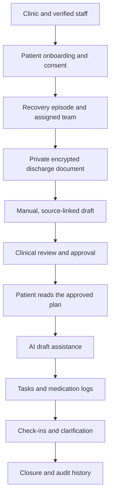

# Velora

**Clinician-controlled post-discharge recovery coordination — a local-first MERN application.**

[](https://github.com/Swayamjain1240/Velora/actions/workflows/ci.yml)
[](package.json)
[](#verification)
[](#verification)
[](#verification)
[](#verification)

Velora turns private discharge documentation into **reviewed, approved** recovery plans.
Patients and explicitly authorised caregivers then use those approved plans to understand
instructions, record recovery activity, and ask the assigned care team for clarification.

Clinical judgement stays with clinicians: Velora does not diagnose, prescribe, triage, certify
recovery, or publish AI output automatically. Uploading a document or receiving an AI draft can
never activate patient instructions, tasks, or reminders — a named, clinic-verified reviewer must
approve a specific plan version first.

> **Scope.** Velora runs locally for development, demonstration, and portfolio evaluation. It is
> **not deployed**, not clinically validated, and not authorised for real patient data, diagnosis,
> treatment decisions, or production clinic operations. All demonstrations use **synthetic data**.

---

## Contents

- [Status](#status)
- [Feature scope](#feature-scope)
- [Architecture](#architecture)
- [Quick start](#quick-start)
- [Configuration](#configuration)
- [Scripts](#scripts)
- [Roles and access boundaries](#roles-and-access-boundaries)
- [Security model](#security-model)
- [Provider posture](#provider-posture)
- [Interface](#interface)
- [Verification](#verification)
- [Known limitations](#known-limitations)
- [Documentation](#documentation)
- [Development discipline](#development-discipline)
- [Licence and contact](#licence-and-contact)

---

## Status

| | |
|---|---|
| **Build** | Parts 1–10 implemented and verified locally |
| **Deployment** | None. Localhost only |
| **Data** | Synthetic only; `.invalid` identities |
| **Providers** | No external service selected, connected, or called |
| **Accessibility** | Automated WCAG 2.1 A/AA audit clean; manual AT testing `NOT RUN` — see [limitations](#known-limitations) |
| **Last full local gate** | 20 October 2026 (`npm run test:e2e:all` exit `0`) |

Open owner decisions — deployment host, provider selection, scheduled backups, clinical and
privacy sign-off — are tracked in the [readiness report](docs/VELORA_READINESS_REPORT.md) and the
[Phase A gate list](docs/PHASE_A_GATES.md).

## Feature scope

| Part | Deliverable | State |
|---:|---|---|
| 1 | Repository, authentication (Argon2id, cookie sessions, staff MFA, CSRF, reset/invite) and clinic permissions | Implemented / verified |
| 2 | Patient onboarding, consent history and scoped caregiver access | Implemented / verified |
| 3 | Recovery episodes and care-team assignment | Implemented / verified |
| 4 | Private encrypted discharge-document intake (quarantine, validation) | Implemented / verified |
| 5 | Manual source-linked care plans, clinical review, approval, versioning | Implemented / verified |
| 6 | AI-assisted draft extraction with source citations and reviewed Hindi/English language | Implemented / verified |
| 7 | Medication schedules, daily tasks and actor-attributed logs | Implemented / verified |
| 8 | Clinic-defined check-ins, clarification queue, dashboard and in-app reminders | Implemented / verified |
| 9 | Episode closure, append-only audit search, privacy requests, retention with dry-run/holds, metrics | Implemented / verified |
| 10 | Production hardening, restore drill, key rotation, readiness gate — **not deployed** | Implemented / verified |

Diagnostic (Code 2) and insurance (Code 3) workflows are explicitly outside the active scope.

## Architecture



| Layer | Choice |
|---|---|
| Database | MongoDB + Mongoose; explicit indexes, replica-set transactions |
| API | Node.js + Express — authorization, workflows, provider boundaries |
| Client | React + Vite — accessible, role-specific interfaces |
| Motion | GSAP 3.15, centralised in `client/src/lib/motion.js` |
| Landing visual | Hand-written WebGL, lazy-loaded (4.99 kB gzip), landing page only |
| Tests | Node test runner (server), Vitest (client), Playwright (browser), custom QA harness |

```text
Velora/
  client/            # React + Vite SPA (dark-purple design system)
  server/            # Express API: models, services, policies, workers
  e2e/               # Playwright journeys and viewport/accessibility audits
  qa/                # non-functional harness: security, perf, layout, secret scan
  docs/              # authority documents, UI docs, runbooks and reports
  scripts/           # dev runner, E2E topology orchestrator, env generator
  .github/workflows/ # CI
  .env.example       # every variable, names and placeholders only
```

## Quick start

**Requirements:** Node.js **≥ 22.12** and a local **MongoDB replica set** (writes run inside
transactions, so a standalone `mongod` is not sufficient).

```bash
npm install                        # installs server + client workspaces
cp .env.example .env               # then fill in values
npm run gen:env                    # generates SESSION_PEPPER and the MFA key
npm run mongo:test-rs -w server    # local single-node replica set on :27019
npm run seed -w server             # synthetic clinic + one user per role
npm run dev                        # API on :4000, client on :5173
```

`npm run dev` starts the API and the client together, prefixes their output (`[api]` / `[web]`),
and stops both on `Ctrl+C`. It fails fast with instructions when `.env` is missing. Open
**http://localhost:5173**.

Synthetic development accounts share the password `SyntheticDevPass!24` and use only `.invalid`
addresses.

## Configuration

`.env.example` documents **every** variable with its purpose and a safe placeholder. `.env` is
gitignored and must never be committed.

| Variable | Purpose |
|---|---|
| `MONGODB_URI` / `MONGODB_TEST_URI` | Local replica set (`mongodb://127.0.0.1:27019/...?replicaSet=rs0`) |
| `CLIENT_ORIGIN` | Exact CORS allowlist entry (`http://localhost:5173`) |
| `SESSION_PEPPER` | Server-side session token pepper (generated) |
| `MFA_ENCRYPTION_KEY` | Staff MFA secret encryption key (generated) |
| `DOCUMENT_STORAGE_ROOT` | Absolute path **outside** the repository for encrypted objects |
| `DOCUMENT_ENCRYPTION_KEY` | Separate 32-byte base64 key for document envelopes |
| `PRIVACY_EXPORT_ENCRYPTION_KEY` | Separate key for privacy export artefacts |
| `EXTRACTION_PROVIDER` | `none` (shipped default) or the deterministic local `fake` provider |
| `REMINDER_PROVIDER` | `in_app` (default); external transports are refused, not stubbed |
| `VITE_API_BASE_URL` | The only value exposed to the browser |

Startup is **fail-closed**: a production configuration is refused when it is unusable — plain-HTTP
`CLIENT_ORIGIN`, debug logging, a weak pepper, one key reused across stores, a non-TLS database
connection, or an impossible pool bound.

## Scripts

| Command | Purpose |
|---|---|
| `npm run dev` | API `:4000` + client `:5173` in one process group |
| `npm run mongo:test-rs -w server` | Start the replica-set development database |
| `npm run seed -w server` | Seed the synthetic clinic and one user per role |
| `npm test` | Server (**440**) + client (**105**) suites |
| `npm run lint -w client` | ESLint |
| `npm run build -w client` | Production build |
| `npm run test:e2e:all` | **Merge gate**: fake-provider suite, then provider-disabled suite, one exit code |
| `npm run test:e2e:fake` | Fake-provider journeys only (116 passed + 1 opt-in skip) |
| `npm run test:e2e:none` | Provider-disabled journey only (1 passed) |
| `E2E_PROJECTS=firefox npm run test:e2e:all` | Same gate on another Playwright engine |
| `node qa/layout-snapshot.js` | Blocking layout regression gate (36 snapshots) |
| `node qa/viewport-audit.js` | 144-check, six-size viewport audit |
| `node qa/secret-scan.js [--history]` | Secret scan of the tracked tree or all history |
| `npm run restore:drill -w server` | Logical restore drill (rows, indexes, objects, decryption) |
| `npm run documents:reconcile -w server` | Document dry run (`-- --apply --operator <email>` to repair) |
| `npm run keys:reseal -w server` | Rotatable MFA/document keys, dry run first |
| `npm run evaluate:extraction -w server` | Synthetic extraction evaluation (not clinical) |
| `npm audit --omit=dev` | Production dependency audit |

### Browser gate design

`npm run test:e2e:all` owns the whole stack: it checks the local MongoDB replica set (starting it
when absent), seeds the synthetic clinic, starts the API, starts Vite, waits for readiness, runs
the fake-provider suite, stops the API, restarts it with `EXTRACTION_PROVIDER=none`, runs the
provider-disabled journey, cleans up, and exits **0 only if both phases passed**. It refuses to
reuse or kill a process it did not start, and it uses a dedicated temporary document-store root so
it cannot leave orphans in the development store.

Two topologies exist because they assert opposite things: every AI journey needs the deterministic
local provider, while the fail-closed journey needs the shipped default with **no** provider.
Running both in a single API process can only make one of them skip or fail — which is why the gate
restarts the API between phases. The provider-disabled assertion is never run against the fake
provider, and no test is skipped or retried to obtain a green result.

To drive Playwright manually (a single topology, **not** the merge gate):

```bash
EXTRACTION_PROVIDER=fake NODE_ENV=test PORT=4100 node server/src/index.js   # terminal 1
VITE_API_PROXY=http://127.0.0.1:4100 npm run dev -w client                  # terminal 2
EXTRACTION_PROVIDER=fake npx playwright test                                # terminal 3
```

`NODE_ENV=test` disables only the in-process blanket rate limiter; the durable Mongo-backed
per-route limits stay active. Run alternate engines as **separate invocations** — the global setup
re-seeds once per process, so several engines in one invocation leave the later ones against a
consumed fixture. One journey is opt-in: start the API with `DOCUMENT_PARSER_TIMEOUT_MS=50` and run
`E2E_QUARANTINE=1 npx playwright test e2e/documents-quarantine.spec.js` to watch a valid file be
quarantined end to end. It reports as skipped in a normal run.

## Roles and access boundaries

| Role | Boundary |
|---|---|
| Patient | Own records and the current approved plan; no clinical approval, no drafts |
| Caregiver | Only explicitly active granular scopes; no automatic document or plan access |
| Care coordinator | Assigned operational coordination and manual draft authoring |
| Clinical reviewer | Assigned review, clarification and approval after clinic verification |
| Clinic admin | Staff and settings; admin status alone grants no clinical-record browsing |

Every protected operation is authorised **on the server** from the authenticated identity, clinic,
role, ownership or active assignment/grant, requested action, and workflow state. React route
guards are a UI layer, never the authorization boundary.

## Security model

- Secrets, keys and credentials never enter Git, React bundles, screenshots, logs or error
  responses; `MONGODB_URI` and every credential are server-only.
- Passwords use **Argon2id** and are never stored in plaintext or reversibly.
- Revocable server-side sessions in `httpOnly` cookies, mandatory staff MFA, CSRF protection, and an
  exact CORS allowlist.
- Bodies, params, queries, headers, forms, filenames and uploads are validated and sanitised;
  NoSQL/operator injection and XSS are prevented.
- Security headers, structured safe errors, rate and resource limits, dependency audits, and Git
  secret scans over the tree and full history.
- Every response defaults to `Cache-Control: no-store, private`; body-parser failures answer
  `413`/`400`/`415`, never `500`.
- At most **one** active staff invitation exists per clinic + email pair.

The complete 25-point contract lives in the [Master document](docs/VELORA_MERN_MASTER.pdf); the
threat model is in [docs/VELORA_THREAT_MODEL.md](docs/VELORA_THREAT_MODEL.md).

## Provider posture

Velora is provider-neutral in code and **local-only in configuration**: nothing is connected and no
external key exists. Each entry below is a value the startup schema validates, not an intention in
a document.

| Capability | Local selection | Evidence |
|---|---|---|
| Hosting | Localhost only (`:4000` API, `:5173` client) | No deployment config in the tree; `TRUST_PROXY=false` |
| Database | Local MongoDB Community, single-node replica set on `:27019` | `npm run mongo:test-rs -w server` |
| Document storage | Encrypted local filesystem | Absolute `DOCUMENT_STORAGE_ROOT` outside the repo; opaque UUID keys, AES-256-GCM envelopes |
| Email / SMS / WhatsApp / push | Disabled | No transport registered; requesting one is refused with the disclosures it would require |
| Scheduling and jobs | Local, request-driven, no daemon | Occurrence materialisation runs inside the API process with bounded per-call limits |
| OCR / extraction | Offline adapter (`none` shipped, `fake` for journeys) | `none` needs no key and fails closed; `fake` is deterministic and refuses to run in production |
| Monitoring | Local structured logs and probes | JSON logger with deep redaction; `/api/health` (liveness), `/api/ready` (database + storage) |
| Notifications | Simulated, nothing leaves the machine | `in_app` records availability in the recipient's own queue; a delivery is never an acknowledgement |

Mock transports are exercised by tests, never by a real send. The only transport that records an
outcome is the `fake` reminder provider, and it refuses to run in production. A mock that claimed
delivery would hide exactly the failure this project exists to avoid — so the equivalent of a
console mock here is a **refusal plus an in-app record**.

## Interface

The application uses a dark, purple-accented design system; no component hard-codes a colour that
exists in the token set (`client/src/styles/tokens.css`).

- The authenticated shell is fixed to the viewport, with a collapsible sidebar on desktop and a
  compact rail below 900 px; sign out stays visible at every size.
- Motion is centralised in `client/src/lib/motion.js` with `gsap.context()` cleanup. Content is
  never animated from zero opacity, `prefers-reduced-motion` disables animation entirely, and no
  transition exceeds 450 ms.
- The landing hero carries the **Recovery Network**, a decorative WebGL scene that is lazy-loaded,
  never runs on an authenticated screen, contains no patient data, and falls back to a static
  gradient without WebGL.

| Document | Purpose |
|---|---|
| [Design system](docs/UI_DESIGN_SYSTEM.md) | Tokens, surfaces, shell, motion, dependency and bundle decisions |
| [Route and screen inventory](docs/UI_ROUTE_SCREEN_INVENTORY.md) | Every route, screen and guard |
| [Responsive matrix](docs/UI_RESPONSIVE_MATRIX.md) | Six required sizes, measured |
| [3D recovery network](docs/UI_3D_RECOVERY_NETWORK.md) | Concept, tiers, cleanup, failure modes, tests |

## Verification

All figures below were measured locally on the final code tree; nothing here is projected.

| Gate | Result |
|---|---|
| Server tests | **440 / 440** (exit `0`), against replica-set MongoDB |
| Client tests | **105 / 105** (18 files) |
| Lint / build | ESLint exit `0`; build exit `0` (main 467.74 kB / 133.67 kB gzip; 3D scene 4.99 kB gzip) |
| Browser gate | Fake provider **116 passed + 1 opt-in skip, 0 failed**; provider-disabled **1 passed**; **combined exit `0`**, unexpected failures `0` |
| Accessibility | axe WCAG 2.1 A/AA **0 violations across 34 screen states**; keyboard, 200 %/400 % reflow, reduced-motion and forced-colours checks pass |
| Layout | `qa/layout-snapshot.js` **36 / 36**; L16 width gate **31 / 31**; route×viewport overflow **21/60 → 0/60** |
| Dependencies | `npm audit` **0**, `npm audit --omit=dev` **0** |
| Secrets | Tree and full-history scans **clean** (411 tracked files, 867 revisions at the gate revision; two reviewed synthetic fixtures allowlisted by value fingerprint) |
| Recovery | Restore drill **passed**; document reconciliation **0 missing, 0 unreadable, 0 mismatches, 0 orphans** |

**Browser engines, precisely.** The final gate executed Playwright's **Chromium** engine.
Playwright's **Firefox** and **WebKit** engines ran the full suite in the 19 October pass
(Firefox 77/77; WebKit 76 passed, 0 failures, 3 skips including a WebKit-only keyboard limitation,
[L6](docs/UI_KNOWN_LIMITATIONS.md)) and were **not** re-run in the final pass. None of this
constitutes testing on **real Safari**, **real Firefox**, or a **physical device** — those remain
`NOT RUN`.

## Known limitations

Recorded with severity and owner in [docs/UI_KNOWN_LIMITATIONS.md](docs/UI_KNOWN_LIMITATIONS.md):

- **Manual assistive-technology testing is `NOT RUN`** — NVDA, VoiceOver and TalkBack have not been
  exercised. Accessibility remains **`PARTIAL`**; no WCAG conformance is claimed.
- **No deployment** and no production MongoDB auth/TLS exercise.
- **No scheduled backup**, therefore no RPO/RTO commitment; the drill is logical, same-host and
  synthetic.
- **3D scene performance on real devices is unmeasured** (the fallback path is tested).
- **No i18n / RTL / locale pass.**
- **Major dependency migrations deferred** (Express 5, Mongoose 9, Zod 4, React 19, ESLint 10) —
  accepted risk for local development, not open advisories.
- **No clinical, legal, or production-readiness claim** of any kind.

## Documentation

| Document | Purpose |
|---|---|
| [Master](docs/VELORA_MERN_MASTER.pdf) | Product scope, requirements, roadmap, clinical invariants, security controls |
| [Architecture](docs/VELORA_MERN_ARCHITECTURE.pdf) | System design, trust boundaries, data model, access policy, state machines |
| [Duck log](docs/VELORA_MERN_DUCK_LOG.pdf) | Project truth, evidence classes, review procedure, completion gates |
| [System design](docs/VELORA_SYSTEM_DESIGN.md) · [Architecture notes](docs/VELORA_ARCHITECTURE.md) | Implementation-level design of the API and data model |
| [Operations runbook](docs/VELORA_OPERATIONS_RUNBOOK.md) | Backup, restore, rotation, reconciliation, incident procedures |
| [Threat model](docs/VELORA_THREAT_MODEL.md) · [Security audit](docs/FINAL_SECURITY_AUDIT.md) | Adversary model and measured results |
| [Readiness report](docs/VELORA_READINESS_REPORT.md) · [Phase A gates](docs/PHASE_A_GATES.md) | What remains before any real deployment |
| [Local closure report](docs/FINAL_LOCAL_CLOSURE_REPORT.md) | Final local gate evidence and its limitations |
| [Design system](docs/UI_DESIGN_SYSTEM.md) · [Responsive matrix](docs/UI_RESPONSIVE_MATRIX.md) | Tokens, surfaces, shell, motion; six measured sizes |
| [UI known limitations](docs/UI_KNOWN_LIMITATIONS.md) | Every open interface gap with severity and owner |
| [Provider decisions](docs/VELORA_PROVIDER_DECISIONS.md) | Candidate vendors and the disclosures each would require |

A roadmap item is not evidence that a feature exists. Passing tests do not establish zero bugs,
clinical validation, regulatory compliance, or production readiness.

## Development discipline

1. Work on a focused feature branch.
2. After each coherent change, run the relevant tests and inspect the diff.
3. Make one meaningful commit; push only when authorised.
4. Run the full gate, security audit and review before merging.
5. Update this README and the applicable documents so they describe real behaviour.

### One-viewport rule

Every authenticated screen must fit a single viewport without page-level vertical scrolling: long
forms use multi-step wizards, long lists use server pagination, dense sections use tabs or separate
routes, and mobile shows one primary panel. `overflow: hidden` must never cut required content.
Verified sizes: `1440×900`, `768×1024`, `390×844`, `320×568`, `844×390`, `320×400`. The marketing
landing page may intentionally scroll.

### Data boundary

Development uses synthetic identities and synthetic documents only. A document status of `ready`
means the upload passed **technical** validation and is queued for human review — never that it is
clinically approved. An `approved` plan version means an assigned, clinic-verified reviewer approved
that exact version; it is not a claim of clinical correctness, and approval activates **no** task or
reminder. AI-assisted extraction is an untrusted drafting aid: it cannot approve, publish, prescribe
or activate anything.

## Licence and contact

This repository is **private and unlicensed** (`"private": true`, `UNLICENSED`): no permission to
copy, modify, or redistribute is granted by its publication.

Maintained by **Swayam Jain** — [github.com/Swayamjain1240](https://github.com/Swayamjain1240).
