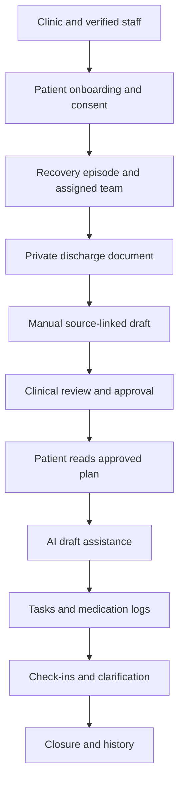

# Velora

**Secure, clinician-controlled post-discharge recovery coordination.**

[](https://github.com/Swayamjain1240/Velora/actions/workflows/ci.yml)


Velora is a JavaScript MERN application that helps clinics turn private discharge
information into clinician-approved recovery plans. Patients and explicitly
authorized caregivers then use those approved plans to understand instructions,
record recovery activity and ask the assigned care team for clarification.

Velora does **not** diagnose, prescribe, decide clinical urgency, certify
recovery or publish AI output automatically. Manual clinical approval always
comes before AI assistance: uploading a document or receiving an AI result can
never activate patient instructions, tasks or reminders.

> **Status — 19 October 2026:** Parts 1–10 are implemented and verified locally
> (not deployed). The UI redesign is at **stage 2**: stage 1's tokens, shell,
> auth, landing, 3D hero, phone layout and accessibility audit, plus the
> stage-2 overlay primitives (`Dialog`, `Toast`, `Tooltip` and a keyboard-
> reachable `ScrollRegion`). The browser journeys now run on **Chromium, Firefox
> and WebKit**, not Chromium alone. Still open by design: no deployment, no
> external provider, no scheduled backup, no real destructive deletion, no real
> patient data and no clinical validation — the owner, clinical, privacy and
> provider decisions are listed in the
> [readiness report](docs/VELORA_READINESS_REPORT.md).

## Quick start

Requirements: **Node.js ≥ 22.12** and a local **MongoDB replica set** (writes
run inside transactions, so a plain `mongod` is not enough).

```bash
npm install                        # installs server + client + e2e workspaces
cp .env.example .env               # then fill in values
npm run gen:env                    # generates SESSION_PEPPER and the MFA key
npm run mongo:test-rs -w server    # local single-node replica set on :27019
npm run seed -w server             # synthetic clinic + one user per role
npm run dev                        # ONE command: API on :4000, client on :5173
```

`npm run dev` starts the API and the client together, prefixes their output
(`[api]` / `[web]`), and stops both on Ctrl+C. It fails fast with instructions
if `.env` is missing. Open **http://localhost:5173**.

Synthetic development accounts share the password `SyntheticDevPass!24` and use
only `.invalid` addresses.

### Environment variables

`.env.example` documents **every** variable with its purpose and a safe
placeholder; `.env` is gitignored and must never be committed. Copy the example,
then generate the secrets:

```bash
npm run gen:env    # fills SESSION_PEPPER and MFA_ENCRYPTION_KEY with safe random values
```

Required server variables (fail closed at startup): `MONGODB_URI`,
`CLIENT_ORIGIN`, `SESSION_PEPPER`, `MFA_ENCRYPTION_KEY`. Part 4 adds
`DOCUMENT_STORAGE_ROOT` (an absolute path **outside** the repository) and
`DOCUMENT_ENCRYPTION_KEY` (a separate 32-byte base64 key). Part 9 adds
`PRIVACY_EXPORT_ENCRYPTION_KEY`. The browser receives only `VITE_API_BASE_URL`.

Key points, all documented in `.env.example`:

- `MONGODB_URI` / `MONGODB_TEST_URI` point at the local replica set
  (`mongodb://127.0.0.1:27019/...?replicaSet=rs0`) served by `mongo:test-rs`.
- AI extraction ships **disabled** (`EXTRACTION_PROVIDER=none`, no key needed);
  only `none` and a local deterministic `fake` provider exist until an owner
  selects a vendor.
- Reminders ship **in-app only** (`REMINDER_PROVIDER=in_app`), which needs no key.
- Production configuration is **refused** at startup when unusable (plain-HTTP
  `CLIENT_ORIGIN`, debug logging, a weak pepper, one key reused across stores,
  a non-TLS database connection, an impossible pool bound).

## Features

| Part | Deliverable | State |
|---:|---|---|
| 1 | Repository, authentication (Argon2id, cookie sessions, staff MFA, CSRF, reset/invite) and clinic permissions | Implemented / verified |
| 2 | Patient onboarding, consent history and scoped caregiver access | Implemented / verified |
| 3 | Recovery episodes and care-team assignment | Implemented / verified |
| 4 | Private encrypted discharge-document intake (quarantine, validation) | Implemented / verified |
| 5 | Manual source-linked care plans, clinical review, approval, versioning — completes synthetic M1 | Implemented / verified |
| 6 | AI-assisted draft extraction with source citations and reviewed Hindi/English language | Implemented / verified |
| 7 | Medication schedules, daily tasks and actor-attributed logs | Implemented / verified |
| 8 | Clinic-defined check-ins, clarification queue, dashboard and in-app reminders | Implemented / verified |
| 9 | Episode closure, append-only audit search, privacy requests (export/correction/deletion), retention with dry-run/holds, metrics | Implemented / verified |
| 10 | Production hardening, restore drill, key rotation, readiness gate — **not deployed** | Implemented / verified |

Code 2 diagnostic tests/results and Code 3 insurance remain outside the active scope.



## Tech stack

| Layer | Choice |
|---|---|
| Database | MongoDB + Mongoose, indexes and replica-set transactions |
| API | Express.js + Node.js — authorization, workflows, provider boundaries |
| Client | React.js + Vite — accessible role-specific interfaces |
| Motion | GSAP 3.15, centralised in `client/src/lib/motion.js` |
| 3D hero | Hand-written WebGL, lazy-loaded (4.99 kB gzip), landing page only |
| Testing | Node test runner (server), Vitest (client), Playwright (browser) |

Dependencies are pinned in `package-lock.json`; `npm audit` reports **0
vulnerabilities** (after the 18 October Vite 8 / Vitest 5 upgrade). No external
storage, AI/OCR, antivirus, notification, queue, hosting or managed database
provider is selected; any vendor must be disclosed before use (control #22).
Candidates and required disclosures are in
[docs/VELORA_PROVIDER_DECISIONS.md](docs/VELORA_PROVIDER_DECISIONS.md).

## Project structure

```text
Velora/
  client/            # React + Vite SPA (dark-purple design system)
  server/            # Express API, models, services, policies, workers
  e2e/               # Playwright journeys + viewport/a11y audits
  qa/                # non-functional harness: security, perf, layout gate
  docs/              # authority PDFs, UI docs, runbooks, reports
  scripts/           # dev runner, env generator
  .github/workflows/ # CI
  .env.example       # every variable, names and placeholders only
```

## Roles and access boundaries

| Role | Boundary |
|---|---|
| Patient | Own records and the current approved plan; no clinical approval, no drafts |
| Caregiver | Only explicitly active granular scopes; no automatic document/plan access |
| Care coordinator | Assigned operational coordination and manual draft authoring |
| Clinical reviewer | Assigned review, clarification and approval after clinic verification |
| Clinic admin | Staff and settings; admin status alone grants no clinical-record browsing |

Every protected operation is enforced on the Express server using the
authenticated identity, clinic, role, ownership or active assignment/grant,
requested action and workflow state. React route protection is a UI layer, not
the authorization boundary.

## Commands

```bash
npm run dev                              # API :4000 + client :5173, one command
npm run mongo:test-rs -w server          # start the replica-set dev database once
npm run seed -w server                   # synthetic clinic + one user per role
npm test                                 # server (424) + client (98) tests
npm test -w server                       # 424 unit + integration tests
npm test -w client                       # 98 client unit tests (Vitest)
npm run lint -w client                    # ESLint
npm run build -w client                   # production build
npx playwright test                       # 78 journeys (76 pass + 2 by-design skips): axe/zoom/forced-colours
E2E_PROJECTS=firefox,webkit npx playwright test   # the same suite on Firefox and WebKit
node qa/layout-snapshot.js               # blocking layout regression gate (36 snapshots)
node qa/viewport-audit.js                # 144-route six-size viewport audit
npm run restore:drill -w server          # logical restore drill (rows+indexes+objects+decryption)
npm run documents:reconcile -w server    # document dry run (add -- --apply --operator <email>)
npm run keys:reseal -w server            # rotatable MFA/document keys, dry-run first
npm run evaluate:extraction -w server    # synthetic extraction evaluation (not clinical)
npm run gen:env                          # generate local secret values
npm audit --omit=dev                     # production dependency audit
```

### Verified evidence

- Server **424/424** tests pass against replica-set MongoDB.
- Client **98/98** tests, ESLint clean, production build clean
  (initial 466.52 kB / 133.30 kB gzip; 3D scene chunk 4.99 kB gzip).
- Browser journeys **78 per engine, 0 failures** against the documented topology:
  Chromium **76 passed + 2 by-design skips**, Firefox **76 + 2**, WebKit
  **75 + 3** (the third skip is the keyboard journey, which Playwright's WebKit
  build cannot run — proved and recorded as [L6](docs/UI_KNOWN_LIMITATIONS.md)),
  plus the provider-disabled journey run separately under
  `EXTRACTION_PROVIDER=none`.
- axe (WCAG 2.1 A/AA): **0 violations across 15 screens** on all three engines;
  200 %/400 % reflow, phone table stacking and forced-colours checks pass.
- `qa/viewport-audit.js` 144 checks, 0 failures; `qa/hero-browser-test.js`
  18/18; `qa/layout-snapshot.js` 36/36 against the committed baseline.
- `npm audit`: 0 (dev and production). Documentation links re-checked after this
  pass: 99 local targets 0 broken, 6 external URLs all 200.

### Running the browser journeys

The Playwright suite needs the stack running and reseeds the synthetic clinic
itself. Start the API the way CI starts it (the provider-disabled spec guards
itself with the same variable, so export it to Playwright too):

```bash
EXTRACTION_PROVIDER=fake NODE_ENV=test PORT=4100 node server/src/index.js   # terminal 1
EXTRACTION_PROVIDER=fake PORT=4100 npx playwright test                      # terminal 2
```

`NODE_ENV=test` switches off only the in-process blanket rate limiter; the
durable Mongo-backed per-route limits stay active. This matters: a full suite
against a `development` API trips the 300 req/min limiter and the status check
lands in the designed retry state (measured — see L14). To repeat the suite on
the other engines, append `E2E_PROJECTS=firefox`, `E2E_PROJECTS=webkit` or both,
comma-separated — but run them as **separate invocations**: the global setup
re-seeds the synthetic clinic once per process, so several engines inside one
invocation leave the later engines against a fixture the first one already
consumed (the symptom is an already-enrolled MFA account and a plan version that
already exists). One journey is opt-in: start
the API with `DOCUMENT_PARSER_TIMEOUT_MS=50` and run
`E2E_QUARANTINE=1 npx playwright test e2e/documents-quarantine.spec.js` to watch
a valid file be quarantined end to end; it reports as skipped in a normal run.

## Interface

The application uses a dark, purple-accented design system documented in
[docs/UI_DESIGN_SYSTEM.md](docs/UI_DESIGN_SYSTEM.md); the pre-implementation
audit is in [docs/UI_REDESIGN_DUCK_REVIEW.md](docs/UI_REDESIGN_DUCK_REVIEW.md).

- Tokens live in `client/src/styles/tokens.css`; no component hard-codes a
  colour that exists there.
- The authenticated shell is fixed to the viewport with a collapsible sidebar on
  desktop and a compact rail below 900 px; sign out stays visible at every size.
- Motion is centralised in `client/src/lib/motion.js` (`gsap.context()`
  cleanup); content is never animated from zero opacity, `prefers-reduced-motion`
  disables animation entirely, and no transition exceeds 450 ms.
- The landing hero carries the **Recovery Network**, a decorative WebGL scene
  that is lazy-loaded, never runs on an authenticated screen, contains no
  patient data, and falls back to a static gradient without WebGL. See
  [docs/UI_3D_RECOVERY_NETWORK.md](docs/UI_3D_RECOVERY_NETWORK.md).

| Document | Purpose |
|---|---|
| [docs/UI_DESIGN_SYSTEM.md](docs/UI_DESIGN_SYSTEM.md) | tokens, surfaces, shell, motion, dependency and bundle decisions |
| [docs/UI_ROUTE_SCREEN_INVENTORY.md](docs/UI_ROUTE_SCREEN_INVENTORY.md) | every route, screen and guard |
| [docs/UI_COMPONENT_INVENTORY.md](docs/UI_COMPONENT_INVENTORY.md) | shared, shell and feature components |
| [docs/UI_ANIMATION_GUIDELINES.md](docs/UI_ANIMATION_GUIDELINES.md) | motion rules, GSAP/three ownership, forbidden effects |
| [docs/UI_ACCESSIBILITY_CHECKLIST.md](docs/UI_ACCESSIBILITY_CHECKLIST.md) | what passed, what was not run |
| [docs/UI_RESPONSIVE_MATRIX.md](docs/UI_RESPONSIVE_MATRIX.md) | six required sizes, measured |
| [docs/UI_3D_RECOVERY_NETWORK.md](docs/UI_3D_RECOVERY_NETWORK.md) | 3D concept, tiers, cleanup, failure modes, tests |
| [docs/UI_VISUAL_REGRESSION.md](docs/UI_VISUAL_REGRESSION.md) | baseline screenshots and diff method |
| [docs/UI_STAGE1_QA_REPORT.md](docs/UI_STAGE1_QA_REPORT.md) | verdict, evidence, defects, not-run list |
| [docs/UI_KNOWN_LIMITATIONS.md](docs/UI_KNOWN_LIMITATIONS.md) | every open UI gap with severity and owner |

Still open (recorded with severity and owner in
[docs/UI_KNOWN_LIMITATIONS.md](docs/UI_KNOWN_LIMITATIONS.md)): the full stage-3
structural pass, real-device 3D measurement, a screen-reader walkthrough
(NVDA/VoiceOver), a real Safari confirmation of the WebKit keyboard gap, CI
matrix legs for Firefox/WebKit, and i18n.

## One-viewport application rule

Every authenticated application screen must fit within one viewport without
page-level vertical scrolling: long forms use multi-step wizards, long lists use
server pagination, many sections use tabs or separate routes, and mobile shows
one primary panel. `overflow: hidden` must never cut required content. Required
verification sizes are `1440x900`, `768x1024`, `390x844`, `320x568`, `844x390`
and `320x400`. A marketing landing page may intentionally scroll.

## Security

Permanent rules, enforced throughout every part:

- Real secrets, keys and credentials never enter Git, React bundles, screenshots,
  logs or error responses; `MONGODB_URI` and every credential are server-only.
- `.env.example` is committed with names and placeholders only; `.env` never is.
- Passwords use Argon2id and are never stored in plaintext or reversibly.
- Revocable server-side sessions in secure `httpOnly` cookies, mandatory staff
  MFA, CSRF protection and an exact CORS allowlist.
- Bodies, params, queries, headers, forms, filenames and uploads are validated
  and sanitized; NoSQL/operator injection and XSS are prevented.
- Security headers, safe structured errors, rate/resource limits, dependency
  audits and Git secret scans.
- Every API response defaults to `Cache-Control: no-store, private`; a
  body-parser failure answers `413`/`400`/`415`, never `500`.
- At most ONE active staff invitation exists per clinic+email.

The complete 25-point contract is defined in the Master PDF and repeated in
every implementation prompt. The threat model is in
[docs/VELORA_THREAT_MODEL.md](docs/VELORA_THREAT_MODEL.md).

## Project authority

Read these three documents before implementation and whenever the owner says
**Duck**:

| Document | Purpose |
|---|---|
| [Velora MERN Master](docs/VELORA_MERN_MASTER.pdf) | Product scope, VEL-001–VEL-021, roadmap, clinical invariants, 25 security controls |
| [Velora MERN Architecture](docs/VELORA_MERN_ARCHITECTURE.pdf) | System design, trust boundaries, data model, access policy, state machines |
| [Velora MERN Duck Log](docs/VELORA_MERN_DUCK_LOG.pdf) | Project truth, evidence classes, Duck review procedure, completion gates |

A roadmap item is not evidence that a feature exists. Passing tests do not
establish zero bugs, clinical validation, regulatory compliance or production
readiness.

Further documentation: [docs/](docs/) — architecture, system design, runbook,
threat model, readiness report, session log and the per-part design documents.

## Data and readiness boundary

Development uses synthetic identities and synthetic documents only; no real
patient data or clinical files are used. A document status of `ready` means the
upload passed **technical** validation and is queued for human review — it never
means clinically approved. An `approved` care-plan version means an assigned,
clinic-verified reviewer approved that exact version; it is not a claim of
clinical correctness, and approval activates **no** task or reminder. AI-assisted
extraction is an untrusted drafting aid: it cannot approve, publish, prescribe or
activate anything, and no external AI/OCR provider is selected or called.

Before any real-patient pilot, Velora requires clinical workflow review,
privacy/provider decisions, retention and incident processes, verified staff
onboarding, secure deployment, backup plus isolated restore testing, a labelled
clinical extraction evaluation and explicit owner authorization.

## Development and Git discipline

1. Work on a focused feature branch.
2. After each coherent feature or ~300 meaningful lines, run relevant tests and
   inspect the diff.
3. Create one meaningful commit and push it when authorized.
4. Run the complete part gate, security audit and Duck review before merge.
5. Update this README and all applicable documents so they describe real behavior.

## Owner

Velora is maintained by **Swayam Jain**.
