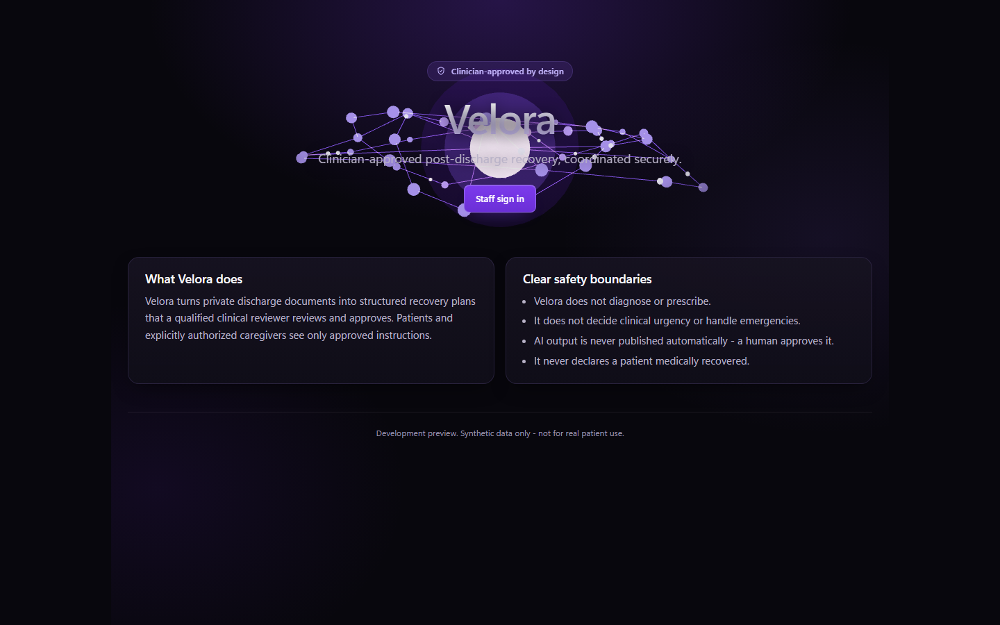
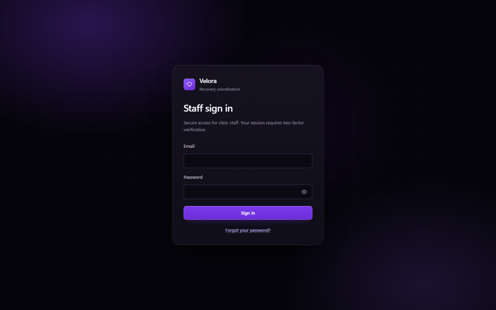
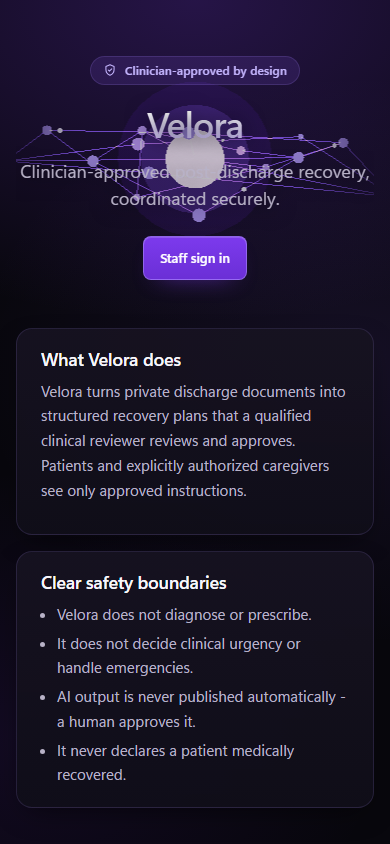
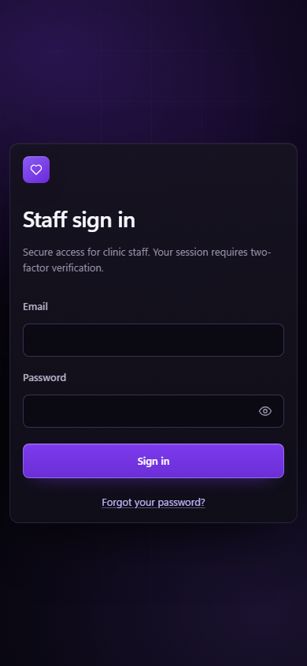
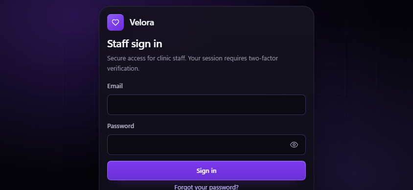
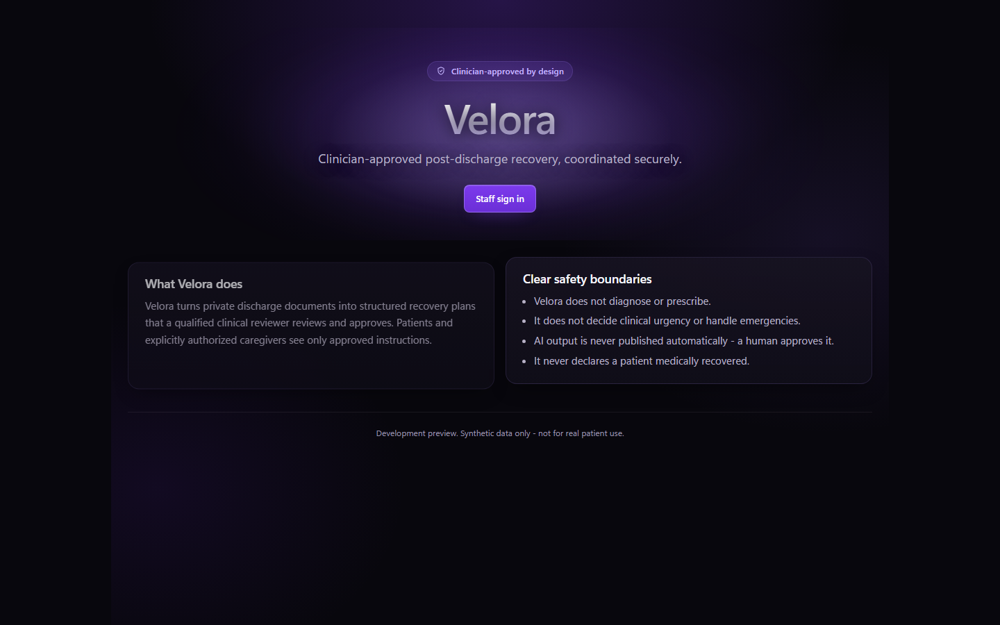
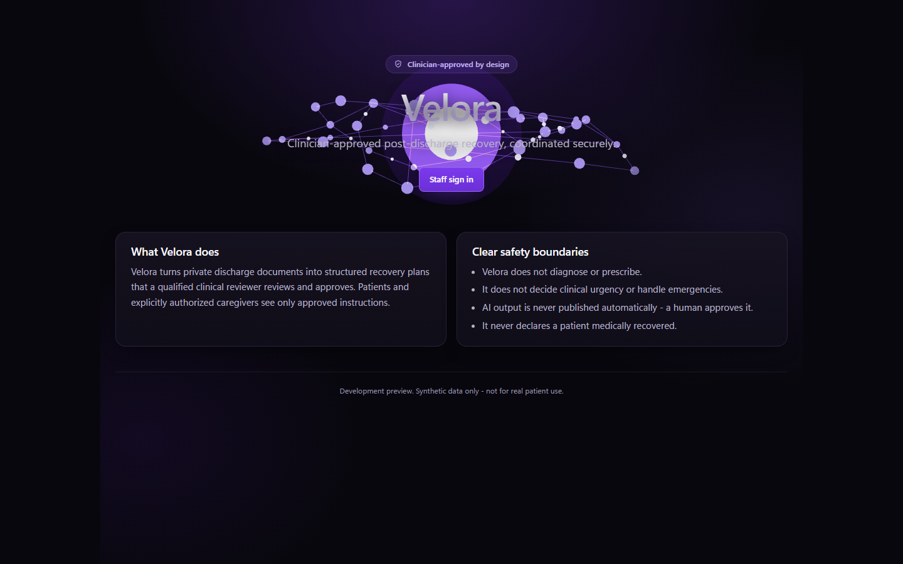

# Velora UI — visual regression report

Baseline images live in `docs/assets/ui-stage1/` and were captured on
`feat/ui-redesign-dark-purple` with Chromium 141 (Playwright) against the seeded
synthetic stack.

## 1. Method

`node qa/ui-visual-capture.js` (needs Vite on 5173) captures, for each of the six
required sizes:

1. the landing page after a 2.6 s settle (entrance finished, orbit moved a known
   amount);
2. the login panel after 0.6 s;

then two special captures at 1440×900: a context with WebGL disabled (static
fallback) and a context with `reducedMotion: 'reduce'`. It also writes
`measurements.json` with the geometry each image was taken from, so a layout
regression is visible as a number even if nobody looks at the picture.

Device pixel ratio is 1 for the desktop capture, 3 for the phone capture, so the
pixel-ratio cap is exercised rather than assumed.

## 2. Baseline set

| File | Size | Shows |
| --- | --- | --- |
| `landing-1440x900.png` | 1440×900 | desktop scene, hero copy, two sections, footer |
| `landing-768x1024.png` | 768×1024 | tablet scene, sidebar-free marketing layout |
| `landing-390x844.png` | 390×844 | phone band behind the headline |
| `landing-320x568.png` | 320×568 | smallest phone |
| `landing-844x390.png` | 844×390 | landscape phone: reduced height, scene kept |
| `landing-320x400.png` | 320×400 | shortest supported viewport |
| `login-<size>.png` (6) | as above | auth panel, brand mark, fields, submit, reset link |
| `landing-1440x900-no-webgl.png` | 1440×900 | static gradient fallback, no canvas |
| `landing-1440x900-reduced-motion.png` | 1440×900 | frozen composition, hero copy at final position |

Every image is reproduced by the single command above; no manual retouching, no
mock data inside the scene.

### Desktop

### Phone

### Landscape phone authentication

### Fallback paths

## 3. What was compared

| Comparison | Result |
| --- | --- |
| Landing and login layout at all six sizes against `measurements.json` | PASSED — document width equals viewport width; hero and sign-in link in the first viewport; login submit visible at every size |
| Scene rendering vs no scene (pixel diff) | PASSED — 4.07 % of the desktop page changes when the canvas is hidden, so the scene is genuinely painted, not a blank canvas |
| Reduced motion vs itself after 900 ms and a pointer move | PASSED — 0.00 % pixel change |
| Motion on, before/after pointer move | PASSED — 0.98–1.02 % change, i.e. parallax is present and subtle |
| Auth panel at 844×390 and 320×400 | **FAILED before the fix**, regressed to PASS after: the submit button used to sit below the fold |

## 4. Visible differences introduced in this revision

1. **Hero scene.** Nodes are now instanced spheres with per-orbit scale, orbital
   rings replace the previous star of spokes, signals travel along real edges, and
   the core gained a second, wider halo. First paint is unchanged (the static
   gradient) because the chunk is lazy.
2. **Hero copy.** A 450 ms stagger on the same clock as the scene, starting at
   0.55 opacity. Final position is identical to the pre-change layout.
3. **Overview cards.** A 380 ms perspective settle (`rotateX 1.4°`), CSS-only,
   skipped under reduced motion.
4. **Short viewports.** The auth panel is top-aligned and 110–120 px shorter at
   844×390 / 320×400, which is what brings the submit button into view.
5. **Phones.** Patient and episode lists render cards instead of squeezed tables.

## 5. Sources of noise (read before diffing)

- The scene is time-based: orbit rotation, breathing and signals mean two captures
  of the landing page are never pixel-identical. Use a tolerance (≤2 % of pixels)
  or compare the `reducedMotion: 'reduce'` captures, which are frozen and stable.
- The hero copy entrance and the page transition must be allowed to finish; the
  capture waits 2.6 s. A shorter wait produces a false diff.
- Web fonts are not loaded (system stack), so text rendering is stable across runs
  on the same OS but not across operating systems.
- Screenshots are Chromium-only; there is no Firefox or WebKit baseline.

## 6. Recommendation

Adopt the reduced-motion set as the blocking visual baseline (deterministic) and
keep the motion set as a reference for reviewers. Diff on a per-size budget:
layout boxes (from `measurements.json`) must be exact; pixels may drift by ≤2 % on
the landing page and ≤0.2 % on every other screen.

### What CI now gates

`qa/layout-snapshot.js` is a blocking step in the e2e job. It records 36
route × size snapshots — page overflow in both axes, main-region width, heading
text, stacked-table count, record-card count and navigation-link count — and
compares them with `qa/baselines/layout.json` (±2 px; the scrollable landing page
has a wider text-metric budget). A structural regression fails the build; an
intended change is adopted with `--update` in the same commit.

Pixel baselines are still captured manually by `qa/ui-visual-capture.js` and are
reviewed as images, not compared automatically. Cross-OS font rendering is why:
a byte comparison of the same page on Windows and Linux is noise. The numbers a
layout regression actually moves are gated; colour and asset regressions remain a
review responsibility, and that is the honest boundary.
